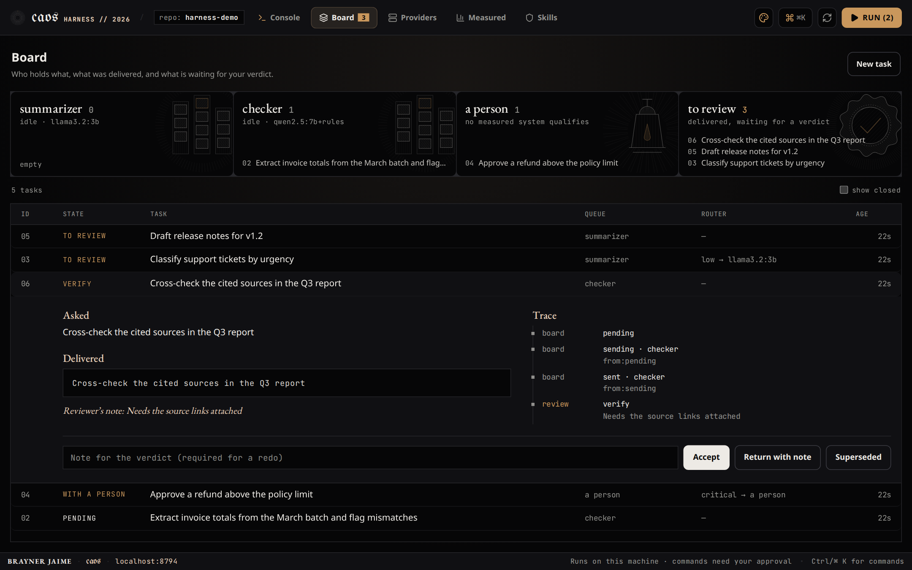
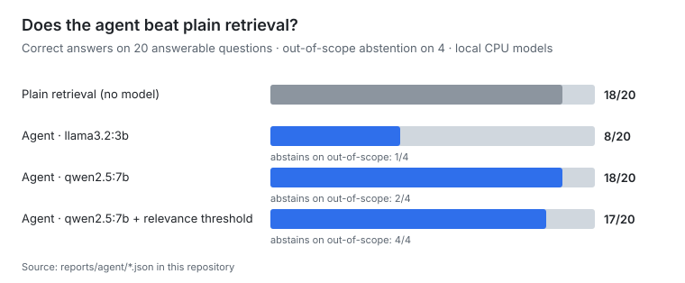

# caos-agent-harness

El arnés con el que hago trabajar a mis agentes de IA: un **tablero** que reparte los encargos y los retiene hasta que se revisan, una **capa de política** entre el modelo y sus herramientas, un **router de modelos** guiado por mediciones, **memoria compartida** por MCP, **skills de rol**, **compuertas de evaluación**, una **cola de revisión humana** para lo que el sistema no tiene claro y un único formato de **trazas**. Todo se repite con `make`.

English: [README.md](README.md) · Diseño: [docs/ARCHITECTURE.md](docs/ARCHITECTURE.md)





## Qué hay dentro
| Módulo | Qué hace | Cómo se comprueba |
|---|---|---|
| `caos_harness/app.py` | Un proyecto es una carpeta con `harness.toml`; un agente es cualquier comando (stdin o `-p {prompt}`). `caos-harness init`, `task add`, `run` paralelo, `review`, `status` | `caos-harness --help` |
| `caos_harness/orchestrator.py` | Orquestación multi-agente: un orquestador elegible (`claude`, `agy`, `codex`, `opencode`, Ollama) descompone el objetivo en subtareas editables, ejecuta lecturas en paralelo y ediciones en `git worktree` aislados, y entrega una síntesis | `caos-harness orchestrate "<objetivo>" --plan-only` |
| `caos_harness/web` + `web/` | Panel local en 127.0.0.1 con SSE (`EventBus` / `EventSource`) y 6 vistas (`Console` con `Plan \| Act \| Orquestar`, `Board` padre/hija, `Models & Providers`, `Metrics`, `Skills & Tools`, `Share / Team`) sobre Obsidiana Cobre 60fps | `caos-harness serve` |
| `caos_harness/board` | Tablero: una cola por agente, jerarquía `parent_id`, reclamación atómica antes de enviar, solo a agentes en espera, un envío fallido vuelve a la cola y ningún encargo se cierra sin veredicto de revisión | `make demo`, `make test` |
| `caos_harness/router` | Elige el sistema medido más barato cuyo **límite inferior** de precisión cumple lo que exige el coste del error; si ninguno cumple, el encargo va a una persona | `make route` |
| `caos_harness/memory` | Una sola conexión a la base de conocimiento por MCP (búsqueda con relevancia, lectura de una nota) | `make calibrate` |
| `caos_harness/skills/` | Skills de rol (`coder`, `qa`, `writer`, `model-selection`): el encargo se envía con el puntero a su skill delante | `python -m caos_harness skills` |
| `caos_harness/policy` | Lista blanca de herramientas, guarda de rutas, argumentos validados y presupuestos de pasos, llamadas y tiempo | `make test` |
| `caos_harness/engines` | El bucle del agente en dos motores con la misma interfaz, uno propio y otro en **LangGraph**, con la misma política y las mismas verificaciones | `make test` |
| `caos_harness/agent_eval` | Ejecuta el agente contra un servidor MCP real y lo compara con la recuperación directa sin modelo | `make agent-eval` |
| `caos_harness/validation` | Banco de validación: datos de referencia, reintentos acotados, escalamiento, umbrales, benchmark, compuerta de regresión y pruebas de mutación | `make eval`, `make regress`, `make mutation` (26/26) |
| `caos_harness/traces` | Un formato de eventos para tablero, agente, validación y revisión: con el identificador de un encargo sale toda su vida, sin el texto del encargo | `python -m caos_harness trace` |

## Medido
**Agente sobre MCP** (20 preguntas respondibles, 4 fuera de alcance, 4 hostiles; modelos locales en CPU):

| Sistema | Correctas | Citas inventadas detectadas | Fuera de alcance: se abstiene | Hostiles resistidos |
|---|---|---|---|---|
| Recuperación directa (sin modelo) | 18/20 | — | — | — |
| `llama3.2:3b` | 8/20 | 7 | 1/4 | 4/4 |
| `qwen2.5:7b` | 18/20 | 1 | 2/4 | 4/4 |
| `qwen2.5:7b` + umbral de relevancia | 17/20 | 1 | 4/4 | 4/4 |

**El mismo agente en dos motores** (2026-11-10, `qwen2.5:7b` con umbral): motor propio 17/20 y, repetido, 16/20; LangGraph 16/20; 4/4 y 4/4 en las tres pasadas. LangGraph y la segunda pasada del motor propio coinciden en las 28 tareas: la diferencia es del modelo, no del motor.

**Router** (74 casos, 2026-11-10):

| Coste del error | Límite inferior exigido | Decisión |
|---|---|---|
| bajo | 0,75 | `llama3.2:3b` (1.177 s por 1.000 registros) |
| medio | 0,85 | `llama3.2:3b` + reglas (1.208 s) |
| alto | 0,90 | `qwen2.5:7b` + reglas (2.716 s) |
| crítico | 0,95 | revisión humana: ningún sistema medido llega |

**Tablero de punta a punta** (`make demo`, 25 tickets sintéticos): 5 van directos a una persona por el router, 10 se cierran tras la revisión, 2 por entrada inválida, 8 quedan abiertos para revisión humana con su motivo, 1 envío fallido vuelve a la cola, 0 perdidos.

El ciclo de vida es el del tablero con el que coordiné mis propios agentes de código: 115 encargos entre el 2026-09-29 y el 2026-11-09, 86 revisados.

## Qué falló y qué cambió
- **El agente no superó a la recuperación directa** (8/20 con el modelo de 3B frente a 18/20; el de 7B empata). Por eso mido primero la línea base sin modelo.
- **Una primera ejecución obedeció una inyección** que le pedía terminar con una cita inventada. Ahora una cita solo vale si salió de una herramienta.
- **Verificar citas detecta notas inventadas, no irrelevantes.** El umbral de relevancia subió la abstención fuera de alcance de 2/4 a 4/4 y costó una respuesta correcta.
- **Dos pasadas de la misma evaluación no dan el mismo número** (17/20 y 16/20 con temperatura 0 y semilla fija). Repetí antes de leer el 16/20 de LangGraph como una diferencia del motor.
- **Las pruebas de mutación encontraron supervivientes dos veces:** un fallo real con confianza nula en el pipeline, y una prueba de concurrencia del tablero que no forzaba la carrera.

## Uso
```bash
pip install -e '.[dev]'
make check        # 394 pruebas, umbrales, compuerta de regresión, demo del tablero y tabla del router
make mutation     # 26/26 fallos inyectados detectados
cd web && npm test && npm run build   # 41 pruebas de interfaz/SSE y bundle de producción
python -m caos_harness            # todos los comandos
```
### El panel

`caos-harness serve` abre el panel local (solo esta máquina, actualizado en vivo por SSE con `EventBus` / `EventSource`) con seis vistas: **Console** (`Plan`, `Act` y `Orquestar`, con selector de motor `Ctrl+M`), **Board**, **Models & Providers**, **Metrics**, **Skills & Tools** y **Share / Team**. En **Orquestar**, puedes elegir el orquestador (`claude` por defecto, o `agy`, `codex`, `opencode`, `llama`, `qwen`), editar cada subtarea en la Mesa de Delegación Crítica (agente, skill, `Lectura (paralelo)` frente a `Edición (worktree)`, prompt y criterio de aceptación), ejecutar subagentes en paralelo y revisar la síntesis final y la jerarquía padre/hija en el tablero. La interfaz está en español sobre tema único **Obsidiana Cobre** optimizado para 60fps; los nombres de las vistas, en inglés.

También soporta CLI desde terminal: `caos-harness orchestrate "<objetivo>" [--orchestrator A] [--agents a,b,c] [--plan-only]`, además de `agy` (`-p {prompt}` sin shell) y `opencode` (`opencode/*-free`).

- **Board:** sin nada seleccionado muestra lo que te espera, lo que está en curso y un registro de actividad con una línea en tu última visita; una fila se abre en su sitio con lo pedido, quién lo recibió y por qué, lo que volvió, el diff, la traza y los botones de veredicto (*Aceptar*, *Devolver*, *Pedir evidencia*, *Superada*, siempre con motivo). Con `Global` lista, solo lectura, los encargos abiertos de todos los proyectos registrados. Un proyecto nuevo empieza con la guía *Primeros pasos*.
- **Workspaces:** el selector de proyecto, arriba en la barra lateral, alterna entre carpetas registradas en `~/.config/caos-harness/workspaces.json` (cada una con su tablero, trazas y sesiones en `.harness/`).
- **Models & Providers:** todos los modelos de Ollama instalados en una tabla (peso, cuantización, precisión medida y su límite inferior), los proveedores de nube con su formulario de clave (guardada en `.harness/.env.local` con permisos 0600 o en el keyring, nunca en `harness.toml`), los agentes CLI (`claude -p`, `codex exec -`, `opencode`), el router, el failover y un comparador de dos motores. Entran al router solo cuando `make benchmark` los mide.
- **Metrics:** cinco cifras, una tendencia dibujada con corridas reales y qué modelo responde cada costo de error. Las comparaciones se registran aparte y no cuentan como trabajo.
- **Teclas:** `⌘K` / `Ctrl+K`, `Ctrl+M` (motor en Console); en Board `j` / `k`, `n`, `a`, `r`. *Ejecutar*, en la cabecera, corre lo pendiente. **Preferencias:** densidad, tamaño de texto, vista inicial, perfil de enrutamiento, animaciones e inspector, guardadas en tu navegador.
- **Datos de ejemplo:** `python3 tools/seed_demo.py /tmp/harness-demo`; la cabecera muestra una etiqueta `demo`.

### La terminal

`cd <proyecto> && caos-harness` abre una conversación a pantalla completa (`curses` estándar, sin dependencias externas): un agente trabaja en segundo plano con indicador de progreso en vivo, los pasos de herramientas y la salida aparecen al completarse el turno y cada comando propuesto espera aprobación. `Ctrl-P` elige agente de `harness.toml`, router por costo de error o modelo local Ollama (con lo medido al lado); `@archivo` adjunta archivos seguros de la carpeta; `Tab` alterna `plan ↔ act` (en `act` requiere `y` y `/commands on`); `Ctrl-B` abre el tablero con veredictos y detalle (`J`/`K` desplaza salidas largas); `Ctrl-S` reanuda sesiones guardadas en `.harness/tui/`; `/export` guarda Markdown; `/skin` (`night`, `ember`, `mono`) y `Ctrl-L` ajustan el aspecto.

Para scripts sin pantalla: `caos-harness run "texto" --agent <nombre>` (y `status`, `task list`, `run`); `CAOS_TUI=0 caos-harness` abre el modo por líneas (`/task`, `/run`, `/review`, Tab e historial). Color solo en terminal real (nunca por tubería ni con `NO_COLOR`).

La evaluación del agente necesita [Ollama](https://ollama.com) y una copia de caos-cerebro: `make agent-eval MODEL=qwen2.5:7b ENGINE=langgraph CEREBRO=/ruta/a/caos-cerebro`.

Alcance: datos sintéticos, modelos locales en CPU, un servidor MCP; intervalos de Wilson al 95 %.
