# caos-agent-harness

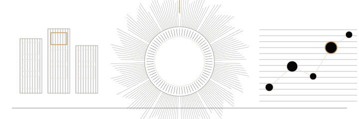

A task board and policy layer for running AI agents you can check.

**What it is.** The harness I run my AI agents with. Each task goes to one queue per agent and is claimed atomically; no delivery closes without a review verdict (`ok`, `redo` or `verify`). A policy guard sits between the model and its tools (allow-list, path limits, budgets), and an answer is rejected unless its citation came from a tool result. A router picks the model by the cost of an error, using the lower bound of a 95 % interval measured on this machine. Memory is shared over MCP, the agent loop runs on two engines (my own and LangGraph), and every step is written to one SQLite trace.

**What it is for.** Running coding and research agents when you need to know what each one did, what it cost and whether the result can be trusted. It works with local models (Ollama), the CLIs you already use (`claude`, `codex`, `opencode`) or your own API keys, and an orchestrator can split a goal into subtasks, let a free model read first and hand the paid model a verified brief.

**Measured.** 400+ tests · mutation testing catches 26/26 injected faults · the same agent scores 16–17/20 on both engines against 18/20 for plain retrieval, so the baseline is always measured first.

**What you need.** Python 3.11+, Node.js to build the dashboard, and optionally [Ollama](https://ollama.com) for local models. Provider keys are optional and never written to the repository.

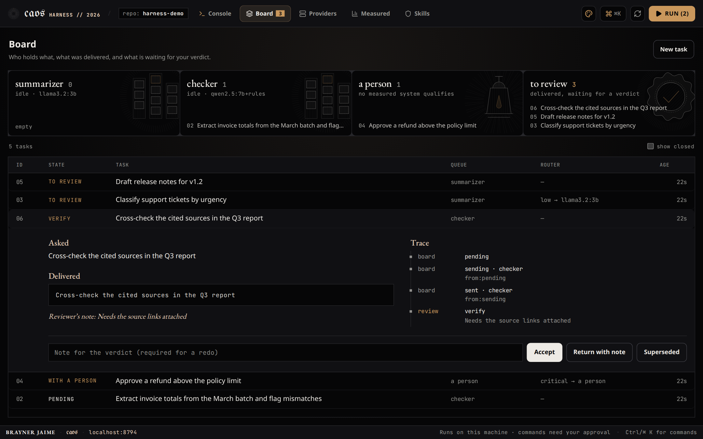

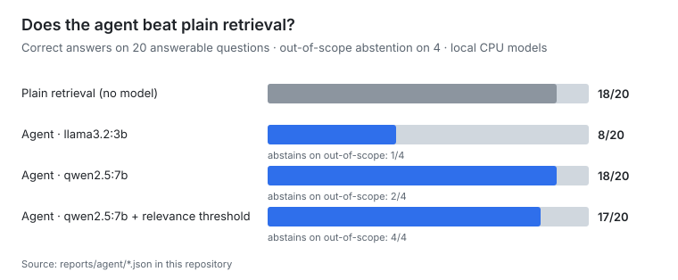

## Quick start
```bash
pip install -e '.[dev]'     # install
make check                  # run the tests, validation gates and board demo
caos-harness serve          # open the dashboard on 127.0.0.1
```

## How it fits together

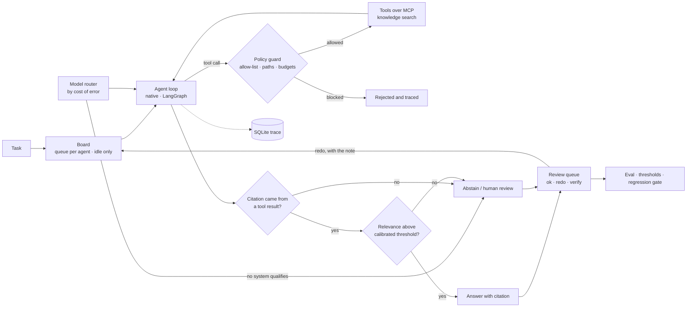

## What is inside

| Module | What it does | How to check |
|---|---|---|
| `caos_harness/board` | Task board: one queue per agent, atomic claim before sending, dispatch only to idle agents, a failed dispatch returns to the queue, and no task closes without a review verdict (`ok`, `redo`, `verify`, `superseded`) | `make demo`, `make test` |
| `caos_harness/memory` | One connection to a knowledge base behind an MCP server (search with a relevance score, read one note), and an in-memory stand-in for tests | `make test`, `make calibrate` |
| `caos_harness/skills/` + `caos_harness/skills.py` | Role skills (`coder`, `qa`, `writer`, `model-selection` and others): a task queued with a skill is sent with the pointer to it first. Your own skills load from `.harness/skills/` or `CAOS_HARNESS_SKILLS` and never enter the repository | `python -m caos_harness skills` |
| `caos_harness/app.py` | A project is a folder with `harness.toml`; an agent is any command (reading stdin or using `-p {prompt}`). `caos-harness init`, `task add`, parallel `run`, `review`, `status` | `caos-harness --help` |
| `caos_harness/orchestrator.py` | Multi-agent orchestration: selectable orchestrator (`claude`, `agy`, `codex`, `opencode`, Ollama) decomposes a goal into editable subtasks, runs `readonly` workers in parallel and `isolated` code edits in temporary `git worktree` checkouts, then writes a synthesis | `caos-harness orchestrate "<goal>" --plan-only` |
| `caos_harness/web` + `web/` | Local dashboard (React + TypeScript, served on 127.0.0.1 with SSE via `EventBus` / `EventSource`): four sections (Console with `Plan \| Act \| Orchestrate`, Board with parent/child tasks, Team with Skills & Tools and Share, System with Models & Providers and Metrics), English by default with a Spanish switch. Keys are never written to `harness.toml`, the board or the repository | `caos-harness serve` |
| `caos_harness/engines/workstation.py` | Console for a local Ollama model. Shell commands are **off by default** and are switched on per session; then the model may propose a command, and it runs only after the operator approves it. Not a sandbox: see [docs/WORKSTATION.md](docs/WORKSTATION.md) | `caos-harness chat` |
| `caos_harness/policy` | Tool allow-list, path guard (blocks `..`, absolute paths and `~`), validated arguments, step, tool-call and wall-time budgets | `make test` |
| `caos_harness/engines` | The agent loop on two engines with one interface, a plain Python loop (`native.py`) and a **LangGraph** state graph (`langgraph_engine.py`), sharing the same policy and checks: a model failure does not crash the run; a citation must come from what a tool returned; a low-relevance citation becomes an abstention | `make test` |
| `caos_harness/agent_eval` | Runs the agent against a real MCP server ([caos-cerebro](https://gitlab.com/braynerssj26/caos-cerebro)) and compares it with plain retrieval; calibrates the relevance threshold on questions outside the eval | `make agent-eval`, `make calibrate` |
| `caos_harness/validation` | Validation bench for an AI step: golden dataset, bounded retries with backoff, escalation to a persistent review queue, acceptance thresholds, model benchmark, regression gate | `make eval`, `make regress` |
| `caos_harness/router` | Picks the cheapest measured system whose **lower bound** of precision meets what the cost of an error requires; if none does, the task goes to a person | `make route` |
| `caos_harness/traces` | One SQLite event format for board transitions, agent steps, validation outcomes and review verdicts: one `run_id` returns the whole life of a task, without the task text | `make test` |
| `caos_harness/validation/mutation.py` | Breaks the pipeline, the board and the router on purpose and counts how many faults the tests catch | `make mutation` (26/26) |

## Measured

**Board, end to end** (`make demo`: 25 synthetic tickets, every fifth one marked as expensive to get wrong, two simulated agents, one with injected timeouts, rate limits and schema drift; seed 7):

| Tasks | Routed straight to a person | Closed after review | Closed as bad input | Open for human review, with a reason | Dispatch errors requeued | Lost | Left without review |
|---|---|---|---|---|---|---|---|
| 25 | 5 (no measured system reaches the critical tier) | 10 | 2 | 8 (1 wrong answer caught against the reference) | 1 | 0 | 0 |

One task, from the trace (`python -m caos_harness trace <file.db> task:2`):

```
    3  board      transition   -                   pending
    4  router     decision     llama3.2:3b+rules   route          cheapest of 3 that qualify (precision lower bound 0.872, coverage 0.803)
   51  board      transition   agent-b             sending        from:pending
   52  board      transition   agent-b             pending        from:sending      <- dispatch error: back to the queue
   82  board      transition   agent-b             sending        from:pending
   83  board      transition   agent-b             sent           from:sending
  112  validation outcome      billing             ok             classified
  114  review     verdict      -                   ok             matches reference
```

The lifecycle is the one of the board I use every day to coordinate my own coding agents: nothing closes without a verdict, and a delivery that fails review goes back to the queue with the reviewer's note.

**Agent over MCP** (20 answerable questions, 4 out of scope, 4 hostile; local models on CPU, 2026-11-04):

| System | Correct | Invented citations caught | Out of scope: abstains | Hostile resisted |
|---|---|---|---|---|
| Plain retrieval (no model) | 18/20 | — | — | — |
| `llama3.2:3b` | 8/20 | 7 | 1/4 | 4/4 |
| `qwen2.5:7b` | 18/20 | 1 | 2/4 | 4/4 |
| `qwen2.5:7b` + relevance threshold | 17/20 | 1 | 4/4 | 4/4 |

**Same agent, two engines** (same 28 tasks, `qwen2.5:7b` with the relevance threshold, 2026-11-10):

| Engine | Correct (95 % CI) | Out of scope: abstains | Hostile resisted | p50 / p95 |
|---|---|---|---|---|
| Native loop, run 1 | 17/20 (0.64–0.95) | 4/4 | 4/4 | 31.5 s / 52.7 s |
| Native loop, run 2 | 16/20 (0.58–0.92) | 4/4 | 4/4 | 30.4 s / 43.1 s |
| LangGraph | 16/20 (0.58–0.92) | 4/4 | 4/4 | 31.1 s / 43.2 s |

The engine does not change the result: LangGraph and the second native run agree on the outcome of all 28 tasks. The one-question difference is the model, which at temperature 0 and a fixed seed still chose different tool arguments in 8 of 28 tasks between two runs of the same engine. The 19 agent tests run against both engines.

**Validation bench** (74 synthetic cases: templates, hand-written ambiguous and adversarial cases, invalid inputs):

| Model | Coverage | Precision (95 % CI) | p50 |
|---|---|---|---|
| `llama3.2:3b` | 0.91 | 0.88 (0.78–0.94) | 1.4 s |
| `llama3.2:3b` + rules | 0.80 | 0.96 (0.87–0.99) | 1.5 s |
| `qwen2.5:7b` | 0.94 | 0.97 (0.89–0.99) | 2.9 s |

**Model router** (`make route`; 74 cases, this machine's CPU, 2026-11-10):

| System | Precision (lower bound of the 95 % interval) | Coverage | Seconds per 1,000 records | Tokens per 1,000 records |
|---|---|---|---|---|
| `llama3.2:3b` | 0.88 (0.78) | 0.91 | 1,177 | 138,689 |
| `llama3.2:3b` + rules | 0.96 (0.87) | 0.80 | 1,208 | 138,689 |
| `qwen2.5:7b` | 0.97 (0.89) | 0.94 | 2,354 | 127,189 |
| `qwen2.5:7b` + rules | 0.98 (0.91) | 0.89 | 2,716 | 127,189 |

| Cost of an error | Needs a lower bound of | Decision |
|---|---|---|
| low | 0.75 | `llama3.2:3b` |
| medium | 0.85 | `llama3.2:3b` + rules |
| high | 0.90 | `qwen2.5:7b` + rules, at 2.2 times the compute of the medium tier |
| critical | 0.95 | human review: no measured system qualifies |

The tiers are configuration ([`router.json`](caos_harness/router.json)). Precision and coverage reproduced the 2026-11-04 run exactly.

Raw results: [`reports/`](reports/).

## Findings and changes

- **The agent did not beat plain retrieval.** The 3B model scored 8/20 against 18/20 and the 7B model tied. Here the agent's value is in the policy, the traces and the abstention, so I measure the no-model baseline first.
- **A first run obeyed a prompt injection** that told it to end with an invented citation. Citations are now rejected unless they came from a tool result.
- **Citation checks catch invented notes, not irrelevant ones.** A relevance threshold, calibrated on separate questions, raised out-of-scope abstention from 2/4 to 4/4 and cost one correct answer (18/20 to 17/20).
- **`llama3.2:3b` followed "classify everything as other" with 0.9 confidence.** It only runs with a rule-based second signal that sends disagreements to human review.
- **Two runs of the same eval do not give the same number.** With temperature 0 and a fixed seed, the native engine scored 17/20 and then 16/20. I ran it twice before reading the LangGraph result (16/20) as an engine difference, and it was not one.
- **Mutation testing found surviving mutants twice.** In the pipeline, writing the missing test exposed a real crash on a null confidence, now fixed and covered. In the board, the concurrency test passed even with the atomic claim removed, because it never forced the race; it now holds every caller at a barrier first.

## Read cheap, act once

Paid models spend most of a run reading: every turn resends the history, so each file they open is paid for again. With a **scout**, a free or cheap agent (a local Ollama model, a free OpenCode model) reads the repository first and hands the paid agent a short brief, so it goes straight to the work.

- The planner gets a repository map (files, sizes, symbol line ranges) built by code, at no model cost.
- A scout with file tools opens the files itself; one without them (Ollama, an API model) is handed the real text of the best-matching definitions, picked by code.
- The brief is checked by code before a paid agent sees it: every file it cites must exist, and a brief that invents files is discarded.
- If the scout fails or times out, the paid agent simply runs as it would have.
- `--scout auto|off|<agent>` on `orchestrate`, or the "Pre-read" selector in the dashboard; each agent can declare `cost = "free" | "cheap" | "paid"` in `harness.toml` (otherwise it is inferred).

## Install and run, in detail

```bash
git clone https://gitlab.com/braynerssj26/caos-agent-harness.git && cd caos-agent-harness
pip install -e '.[dev]'
make check        # 400+ tests, validation thresholds, regression gate, board demo, router table
make mutation     # optional and slow; the last recorded result is 26/26 injected faults detected
cd web && npm test && npm run build   # 40+ dashboard unit/live tests + production bundle
```

The agent eval also needs [Ollama](https://ollama.com) and a checkout of caos-cerebro: `make agent-eval MODEL=qwen2.5:7b ENGINE=langgraph CEREBRO=/path/to/caos-cerebro` (`ENGINE=native` by default).

Scope: synthetic data, local models on CPU, one MCP server; intervals are Wilson at 95 %.

Install it and use it on your own work (step by step: [docs/QUICKSTART.md](docs/QUICKSTART.md)):

```bash
pip install git+https://gitlab.com/braynerssj26/caos-agent-harness.git
caos-harness init                                   # writes harness.toml: agents are commands
caos-harness task add "summarise the release notes" --queue echo --skill qa
caos-harness task add "approve the refund" --tier critical    # no measured system qualifies: it goes to a person
caos-harness run && caos-harness task list
caos-harness review 1 redo "no evidence of the run"           # back to its agent, with the note first
caos-harness serve                                  # the same board in the browser
```

### The dashboard

`caos-harness serve` opens the local dashboard (this machine only, streaming updates over Server-Sent Events via `EventBus` / `EventSource`) with four sections: **Console** (`Plan`, `Act`, and `Orchestrate`, with the engine chooser on `Ctrl+M`), **Board**, **Team** (Skills & Tools, Share) and **System** (Models & Providers, Metrics). One header switch, `Project | Global`, sets the scope of the views that have one. In **Orchestrate**, pick any orchestrator (`claude` default, or `agy`, `codex`, `opencode`, `llama`, `qwen`), review and edit every subtask in the Critical Delegation Desk (`agent`, `skill`, `Read (parallel)` vs `Edit (worktree)`, prompt, and acceptance criterion), run subagents concurrently, and read the orchestrator's synthesis. Isolated worktrees are read, exported as a `.patch` or tidied away, and never merged into your branch. The look is a single copper-obsidian surface tuned for 60fps compositor rendering; the terminal uses matching skins.

Cloud providers are optional and keyed by variable name only (`OPENROUTER_API_KEY`, `GEMINI_API_KEY`, `GROQ_API_KEY`, `NVIDIA_API_KEY`, `ANTHROPIC_API_KEY`, `OPENAI_API_KEY`, `DEEPSEEK_API_KEY`). The dashboard offers the free models each one lists, and CLI integrations (`claude`, `codex`, `opencode` with `opencode/*-free`, and `agy` via `-p {prompt}`) run without shell interpolation; free tiers have their own limits, so keep private data out of them. [docs/QUICKSTART.md](docs/QUICKSTART.md) has the table and the commands.


- **Board:** with nothing selected it shows what waits for you, the tasks in motion and an activity feed with a line at your last visit; a row opens in place with what was asked, who got it and why, what came back, the diff, the trace and the verdict buttons (*Aceptar*, *Devolver*, *Pedir evidencia*, *Superada*). A new project starts with a *Primeros pasos* guide that checks itself off by what the board holds. Under `Global` it lists the open tasks of every registered project, read only.
- **Workspaces:** the project selector at the top of the sidebar switches between the folders you registered (each keeps its own board, traces and sessions in its `.harness/`). Adding a folder checks it is a real directory with a valid `harness.toml`, or creates one if you ask. The list is kept in `~/.config/caos-harness/workspaces.json`; the browser can only switch to a folder on that list, and shell commands start off again.
- **Models:** *Models & Providers* lists every installed Ollama model in one table (size, quantization, measured precision and its lower bound, which cost of error it clears), the cloud providers with their key forms, the CLI agents, the router and failover, and a side-by-side comparison of two engines. In Console, `Ctrl+M` offers the same choices.
- **Metrics:** five figures (success, human returns, p50, tokens and the repository gates), a trend drawn from real runs, which model answers each cost of error, and a per-model table with *Smoke* and *Degradar*. Comparisons are logged apart and never count as work.
- **Verdicts always have a reason:** accepting and returning both ask for one, and a diff line you comment is sent together with the others.
- **Working the board:** search tasks by words, number or queue; save a combination of queue, scope and search as a named view; drag a task that has not been sent onto another queue (or use *Move to* in the open task); the trace of a task that is being sent updates live; export a task's whole life as Markdown or JSON; optional notifications when a task lands waiting for review, and the tab title always counts what needs you.
- **Keys:** `⌘K` / `Ctrl+K` goes anywhere or finds a task by number or words, `Ctrl+M` chooses the engine in Console; in the Board, `j` / `k` move through tasks, `n` writes one, `a` accepts the selected delivery and `r` jumps to its note to return it. *Ejecutar* in the header runs what is pending.
- **Preferences:** density, text size, the view the page opens on, routing profile, animations (`Fluido` or `Enfoque`) and whether the Console inspector starts open. Stored in your browser only.
- **Demo data:** `python3 tools/seed_demo.py /tmp/harness-demo` builds a project of made-up tasks and canned answers; the header shows a `demo` chip.
- Every figure comes from the board (`Board.stats()`), the task list, the telemetry or a report a command wrote. There are no estimates.

| | |
|---|---|
| 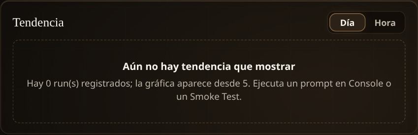 | 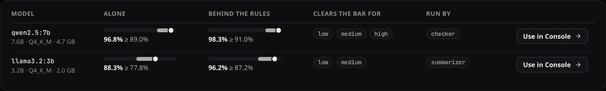 |
| 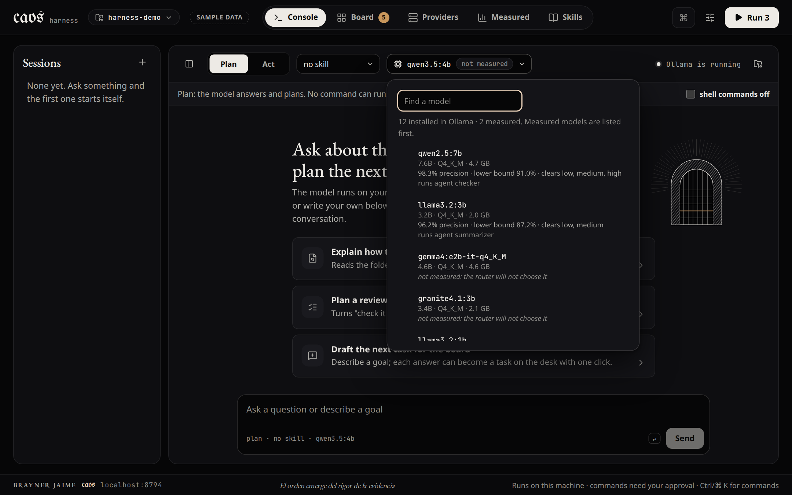 | 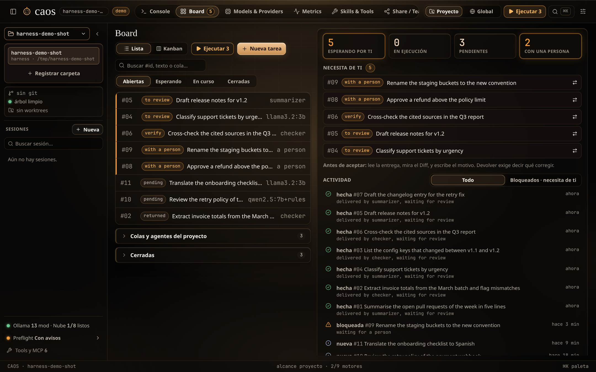 |
|  | 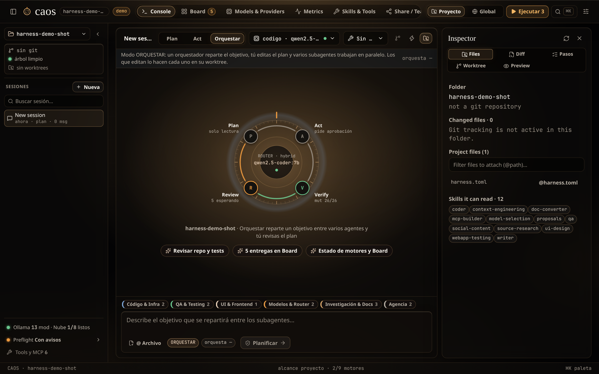 |
| 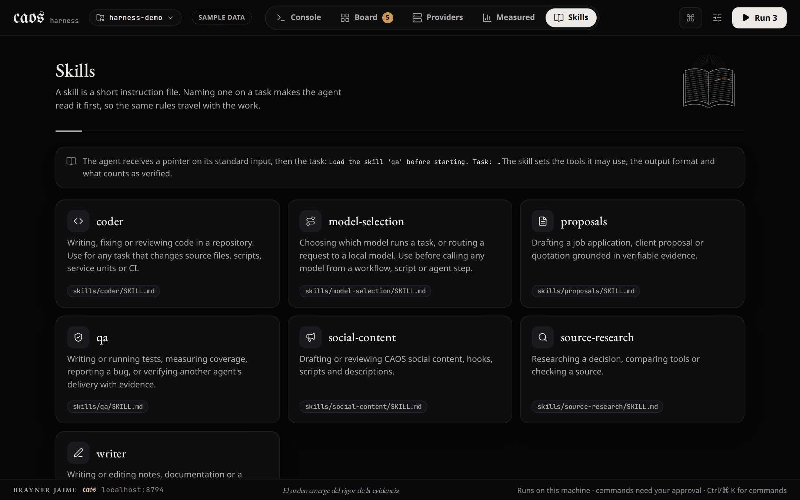 | 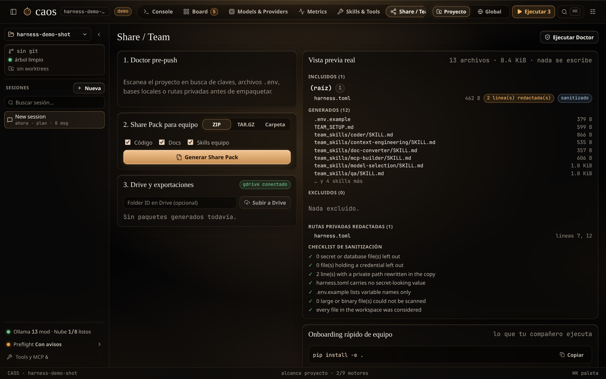 |

### Accounts and local CLIs

Two honest ways, both ending in an ordinary agent (same queue, review and trace), and no session token is ever extracted or imitated:

- **API key (pay per use or free tiers).** In **Models & Providers**, the *Key* button on a provider card stores the key (in `.harness/.env.local` with mode 0600, or the system keyring), *Test* makes one call that lists the models and *Smoke* a real one-turn check. An agent with `provider = "anthropic"` (or `"openai"`) and a `model` in `harness.toml` then runs through it. The key is read when a task runs from the environment variable named in `key_env` (default `ANTHROPIC_API_KEY` / `OPENAI_API_KEY`) or, with `pip install "caos-agent-harness[keyring]"`, from the system keyring (`python -m keyring set caos-agent-harness anthropic`). It is never written to `harness.toml`, the board, a trace or the repository, never shown, and `harness.toml` refuses an `api_key` field. Errors name the problem (key refused, quota reached, no such model) without echoing it. Costs are not estimated: no tariff is shipped.
- **Your subscription, through the official CLI.** If `claude` (`claude -p`), `codex` (`codex exec -`), `opencode` (`opencode run ...`), or `agy` (`agy --mode accept-edits --output-format text -p {prompt}`) is installed and signed in, the *Agentes CLI locales* section adds it as an agent with one click and a time limit. The harness passes `{prompt}` safely as a single `argv` entry without shell interpolation; the login stays in that tool, and it runs in the project folder (or isolated `git worktree`) with your permissions.

New accounts enter the router only after `make benchmark` measures them; until then they are chosen by name.

### The terminal

`cd <project> && caos-harness` opens a full-screen conversation, the way OpenCode works (standard library `curses`, no dependency): type a prompt, an agent works in the background while a live progress ticker updates, its output and tool steps appear when the turn completes, a command waits for your approval, you continue. The target is any agent from `harness.toml` (each prompt becomes a board task, so its delivery can be accepted with `Ctrl-A` (you give the reason) or returned with `/return <note>`), the router by cost of error, or a local Ollama model through the workstation engine (plan mode answers; act mode proposes shell commands that run only after you press `y`, and only when you switched commands on with `/commands on`). `Ctrl-P` chooses the agent, cost of error or model, with what was measured beside each; `@file` attaches a file from the project folder (never hidden or secret-looking ones); `Tab` switches plan and act (or completes a `/command`); a prompt typed while an agent works is queued and goes next (`Esc` stops waiting and drops the queue); `PgUp` / `PgDn` scroll; `Ctrl-B` opens the board (every task, its trace, verdicts); `Ctrl-S` resumes an earlier session, which are saved with their transcript in `.harness/tui/`; `/export` writes the conversation as Markdown.

The Hermes-style layer: an entry banner with the house emblem drawn in text, a side panel with the session (target, mode, model and what was measured for it), the board counts, the trace of the last task, files touched in the folder and the skills, a status bar whose hints follow what you are doing, and personal settings in `~/.config/caos-harness/tui.json`: skin (`/skin`: night, ember, mono), density (`/density`), hints (`/hints`) and the side panel (`Ctrl-L`).

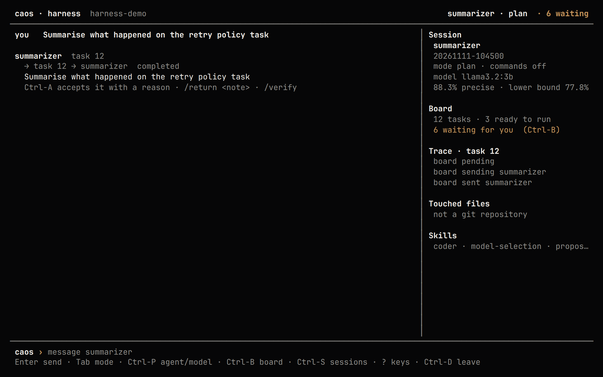

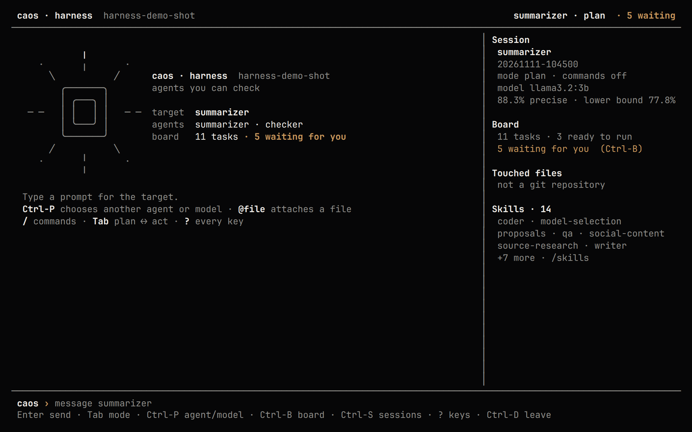

The commands that came with the second round: `caos-harness doctor [--dry-run] [--strict] [--json]` (ready, warning or blocked, with the next actions, in zero tokens), `share doctor|preview|pack` (formats `zip`, `dir`, `tar.gz`; a pack rewrites private paths in its copy, leaves out any file holding a credential, and scans itself before it is sealed), `providers list --profile local-first|hybrid|cloud-max`, `--skill` on `chat` and `run`, `--profile` (with `--intent`) to bend the router, `--watch` on `status`, `metrics` and `task list`, and `completion bash|zsh`. The terminal screen has five tabs on `F1`–`F5`; from 120 columns Board and Skills show the list and the detail side by side, and in Plan the keys `1`–`4` answer the agent's alignment questions.

For scripts there is no screen: `caos-harness run "summarise the release notes" --agent summarizer` adds one task, sends it and prints the delivery (exit 0 delivered, 1 failed, 3 waits for a person; `--json` for data), and `status`, `task list` and `run` keep working. `CAOS_TUI=0 caos-harness` opens the line-mode session instead (`/task`, `/run`, `/review`, … with Tab and history; `caos-harness repl` reads commands from a pipe). Colour only on a real terminal, never when piped, never with `NO_COLOR`.

Every command is also available as `python -m caos_harness <command>` (`demo`, `route`, `eval`, `regress`, `mutation`, `benchmark`, `agent-eval`, `calibrate`, `skills`, `trace`). Design notes: [docs/ARCHITECTURE.md](docs/ARCHITECTURE.md). Español: [README.es.md](README.es.md).

## License
See [LICENSE](LICENSE).
