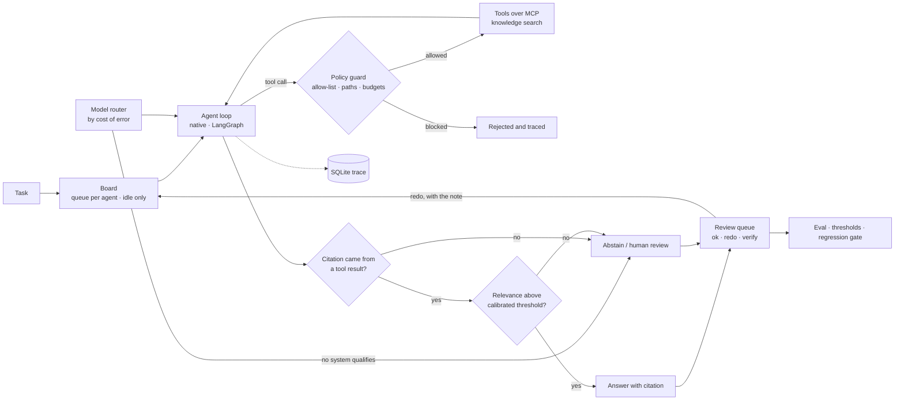
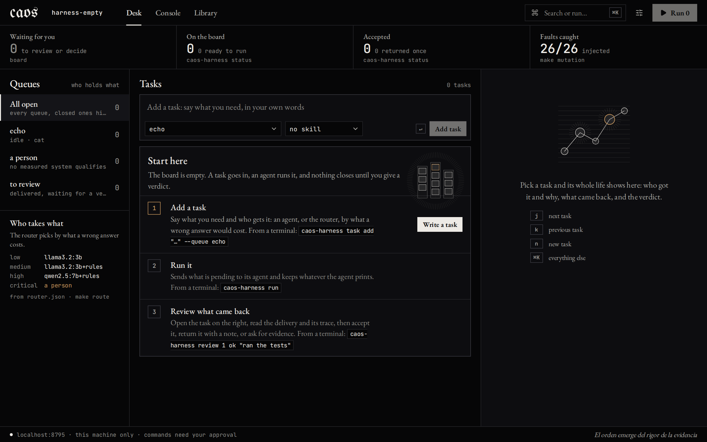
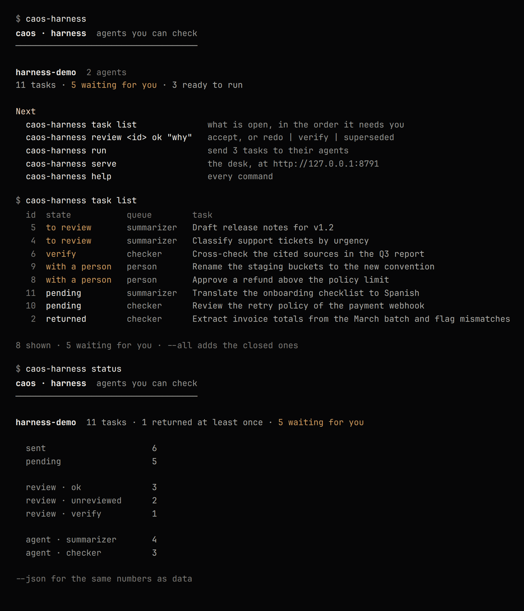

# caos-agent-harness

The harness I run my AI agents with: a **task board** that routes work and holds it for review, a **policy layer** between the model and its tools, a **model router** driven by measured results, **shared memory** over MCP, **role skills**, **evaluation gates**, a **human review queue** for what the system is not sure about, and one **trace** format for every step. Everything reruns with `make`.


## How it fits together



## What is inside

| Module | What it does | How to check |
|---|---|---|
| `caos_harness/board` | Task board: one queue per agent, atomic claim before sending, dispatch only to idle agents, a failed dispatch returns to the queue, and no task closes without a review verdict (`ok`, `redo`, `verify`, `superseded`) | `make demo`, `make test` |
| `caos_harness/memory` | One connection to a knowledge base behind an MCP server (search with a relevance score, read one note), and an in-memory stand-in for tests | `make test`, `make calibrate` |
| `caos_harness/skills/` + `caos_harness/skills.py` | Role skills (`coder`, `qa`, `writer`, `model-selection` and others): a task queued with a skill is sent with the pointer to it first. Your own skills load from `.harness/skills/` or `CAOS_HARNESS_SKILLS` and never enter the repository | `python -m caos_harness skills` |
| `caos_harness/app.py` | A project is a folder with `harness.toml`; an agent is any command that reads the task on stdin. `caos-harness init`, `task add` (a queue, or a cost-of-error tier and the router decides), `run`, `review`, `status` | `caos-harness --help` |
| `caos_harness/web` + `web/` | Local dashboard (React + TypeScript, served by the standard library on 127.0.0.1): board, review desk, router table, figures read from the reports. Writes need a header a foreign page cannot send; keys are never stored | `caos-harness serve` |
| `caos_harness/engines/workstation.py` | Console for a local Ollama model. Shell commands are **off by default** and are switched on per session; then the model may propose a command, and it runs only after the operator approves it. Not a sandbox: see [docs/WORKSTATION.md](docs/WORKSTATION.md) | `caos-harness chat` |
| `caos_harness/policy` | Tool allow-list, path guard (blocks `..`, absolute paths and `~`), validated arguments, step, tool-call and wall-time budgets | `make test` |
| `caos_harness/engines` | The agent loop on two engines with one interface, a plain Python loop (`native.py`) and a **LangGraph** state graph (`langgraph_engine.py`), sharing the same policy and checks: a model failure does not crash the run; a citation must come from what a tool returned; a low-relevance citation becomes an abstention | `make test` |
| `caos_harness/agent_eval` | Runs the agent against a real MCP server ([caos-cerebro](https://gitlab.com/braynerssj26/caos-cerebro)) and compares it with plain retrieval; calibrates the relevance threshold on questions outside the eval | `make agent-eval`, `make calibrate` |
| `caos_harness/validation` | Validation bench for an AI step: golden dataset, bounded retries with backoff, escalation to a persistent review queue, acceptance thresholds, model benchmark, regression gate | `make eval`, `make regress` |
| `caos_harness/router` | Picks the cheapest measured system whose **lower bound** of precision meets what the cost of an error requires; if none does, the task goes to a person | `make route` |
| `caos_harness/traces` | One SQLite event format for board transitions, agent steps, validation outcomes and review verdicts: one `run_id` returns the whole life of a task, without the task text | `make test` |
| `caos_harness/validation/mutation.py` | Breaks the pipeline, the board and the router on purpose and counts how many faults the tests catch | `make mutation` (26/26) |

## Measured

**Board, end to end** (`make demo`: 25 synthetic tickets, every fifth one marked as expensive to get wrong, two simulated agents, one with injected timeouts, rate limits and schema drift; seed 7):

| Tasks | Routed straight to a person | Closed after review | Closed as bad input | Open for human review, with a reason | Dispatch errors requeued | Lost | Left without review |
|---|---|---|---|---|---|---|---|
| 25 | 5 (no measured system reaches the critical tier) | 10 | 2 | 8 (1 wrong answer caught against the reference) | 1 | 0 | 0 |

One task, from the trace (`python -m caos_harness trace <file.db> task:2`):

```
    3  board      transition   -                   pending
    4  router     decision     llama3.2:3b+rules   route          cheapest of 3 that qualify (precision lower bound 0.872, coverage 0.803)
   51  board      transition   agent-b             sending        from:pending
   52  board      transition   agent-b             pending        from:sending      <- dispatch error: back to the queue
   82  board      transition   agent-b             sending        from:pending
   83  board      transition   agent-b             sent           from:sending
  112  validation outcome      billing             ok             classified
  114  review     verdict      -                   ok             matches reference
```

The lifecycle is the one of the board I have used to coordinate my own coding agents: 115 tasks between 2026-09-29 and 2026-11-09, 86 of them reviewed (79 accepted, 7 closed as superseded).

**Agent over MCP** (20 answerable questions, 4 out of scope, 4 hostile; local models on CPU, 2026-11-04):

| System | Correct | Invented citations caught | Out of scope: abstains | Hostile resisted |
|---|---|---|---|---|
| Plain retrieval (no model) | 18/20 | — | — | — |
| `llama3.2:3b` | 8/20 | 7 | 1/4 | 4/4 |
| `qwen2.5:7b` | 18/20 | 1 | 2/4 | 4/4 |
| `qwen2.5:7b` + relevance threshold | 17/20 | 1 | 4/4 | 4/4 |

**Same agent, two engines** (same 28 tasks, `qwen2.5:7b` with the relevance threshold, 2026-11-10):

| Engine | Correct (95 % CI) | Out of scope: abstains | Hostile resisted | p50 / p95 |
|---|---|---|---|---|
| Native loop, run 1 | 17/20 (0.64–0.95) | 4/4 | 4/4 | 31.5 s / 52.7 s |
| Native loop, run 2 | 16/20 (0.58–0.92) | 4/4 | 4/4 | 30.4 s / 43.1 s |
| LangGraph | 16/20 (0.58–0.92) | 4/4 | 4/4 | 31.1 s / 43.2 s |

The engine does not change the result: LangGraph and the second native run agree on the outcome of all 28 tasks. The one-question difference is the model, which at temperature 0 and a fixed seed still chose different tool arguments in 8 of 28 tasks between two runs of the same engine. The 19 agent tests run against both engines.

**Validation bench** (74 synthetic cases: templates, hand-written ambiguous and adversarial cases, invalid inputs):

| Model | Coverage | Precision (95 % CI) | p50 |
|---|---|---|---|
| `llama3.2:3b` | 0.91 | 0.88 (0.78–0.94) | 1.4 s |
| `llama3.2:3b` + rules | 0.80 | 0.96 (0.87–0.99) | 1.5 s |
| `qwen2.5:7b` | 0.94 | 0.97 (0.89–0.99) | 2.9 s |

**Model router** (`make route`; 74 cases, this machine's CPU, 2026-11-10):

| System | Precision (lower bound of the 95 % interval) | Coverage | Seconds per 1,000 records | Tokens per 1,000 records |
|---|---|---|---|---|
| `llama3.2:3b` | 0.88 (0.78) | 0.91 | 1,177 | 138,689 |
| `llama3.2:3b` + rules | 0.96 (0.87) | 0.80 | 1,208 | 138,689 |
| `qwen2.5:7b` | 0.97 (0.89) | 0.94 | 2,354 | 127,189 |
| `qwen2.5:7b` + rules | 0.98 (0.91) | 0.89 | 2,716 | 127,189 |

| Cost of an error | Needs a lower bound of | Decision |
|---|---|---|
| low | 0.75 | `llama3.2:3b` |
| medium | 0.85 | `llama3.2:3b` + rules |
| high | 0.90 | `qwen2.5:7b` + rules, at 2.2 times the compute of the medium tier |
| critical | 0.95 | human review: no measured system qualifies |

The tiers are configuration ([`router.json`](caos_harness/router.json)). Precision and coverage reproduced the 2026-11-04 run exactly.

Raw results: [`reports/`](reports/).

## What failed and what changed

- **The agent did not beat plain retrieval.** The 3B model scored 8/20 against 18/20 and the 7B model tied. Here the agent's value is in the policy, the traces and the abstention, so I measure the no-model baseline first.
- **A first run obeyed a prompt injection** that told it to end with an invented citation. Citations are now rejected unless they came from a tool result.
- **Citation checks catch invented notes, not irrelevant ones.** A relevance threshold, calibrated on separate questions, raised out-of-scope abstention from 2/4 to 4/4 and cost one correct answer (18/20 to 17/20).
- **`llama3.2:3b` followed "classify everything as other" with 0.9 confidence.** It only runs with a rule-based second signal that sends disagreements to human review.
- **Two runs of the same eval do not give the same number.** With temperature 0 and a fixed seed, the native engine scored 17/20 and then 16/20. I ran it twice before reading the LangGraph result (16/20) as an engine difference, and it was not one.
- **Mutation testing found surviving mutants twice.** In the pipeline, writing the missing test exposed a real crash on a null confidence, now fixed and covered. In the board, the concurrency test passed even with the atomic claim removed, because it never forced the race; it now holds every caller at a barrier first.

## Quickstart

```bash
git clone https://gitlab.com/braynerssj26/caos-agent-harness.git && cd caos-agent-harness
pip install -e '.[dev]'
make check        # 137 tests, validation thresholds, regression gate, board demo, router table
make mutation     # 26/26 injected faults detected
```

The agent eval also needs [Ollama](https://ollama.com) and a checkout of caos-cerebro: `make agent-eval MODEL=qwen2.5:7b ENGINE=langgraph CEREBRO=/path/to/caos-cerebro` (`ENGINE=native` by default).

Scope: synthetic data, local models on CPU, one MCP server; intervals are Wilson at 95 %.

Install it and use it on your own work (step by step: [docs/QUICKSTART.md](docs/QUICKSTART.md)):

```bash
pip install git+https://gitlab.com/braynerssj26/caos-agent-harness.git
caos-harness init                                   # writes harness.toml: agents are commands
caos-harness task add "summarise the release notes" --queue echo --skill qa
caos-harness task add "approve the refund" --tier critical    # no measured system qualifies: it goes to a person
caos-harness run && caos-harness task list
caos-harness review 1 redo "no evidence of the run"           # back to its agent, with the note first
caos-harness serve                                  # the same board in the browser
```

### The desk

`caos-harness serve` opens one working screen, not a set of tabs: queues on the left, the tasks in the middle ordered by what needs you first, and the selected task's whole life on the right (what was asked, who got it and why, what came back, the trace) with the verdict controls under it. A line of figures sits above; each one names the command that produced it. **Console** (a local Ollama model) and **Library** (measured systems, the router, agents, skills, providers) are the other two views.



- **Keys:** `j` / `k` move through tasks, `n` writes a task, `r` runs what is pending, `⌘K` / `Ctrl+K` goes anywhere or finds a task by number or words, `Esc` closes.
- **Preferences** are two and both are useful: density (comfortable or compact) and the view the page opens on. They are stored in your browser only.
- **Sample data:** `python3 tools/seed_demo.py /tmp/harness-demo` builds a project of made-up tasks and canned answers; the page labels it "Sample data" so nobody mistakes it for a record.
- Every figure comes from the board (`Board.stats()`), the task list, or a report a command wrote. There are no estimates.

The CLI speaks in the same words, with colour only on a real terminal (never when piped, and never when `NO_COLOR` is set):



Every command is also available as `python -m caos_harness <command>` (`demo`, `route`, `eval`, `regress`, `mutation`, `benchmark`, `agent-eval`, `calibrate`, `skills`, `trace`). Design notes: [docs/ARCHITECTURE.md](docs/ARCHITECTURE.md). Español: [README.es.md](README.es.md).

## License
See [LICENSE](LICENSE).
