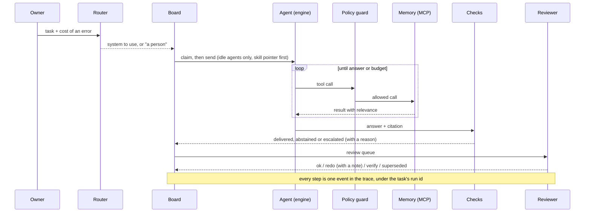

# Architecture

## The problem it solves
An agent that works unattended fails in ways a chat does not: it calls a tool it should not, it cites something it never read, it answers when it should have escalated, two copies of the same task get sent, or a task disappears between "sent" and "done". The harness puts one named component in front of each of those failures and makes each component checkable from the command line.

## Flow of one task

## Modules and their contracts

| Module | Contract | Failure it exists for |
|---|---|---|
| `router` | `choose(profiles, min_precision_lo) -> Decision`. Profiles come from benchmark reports; tiers from `router.json` | Picking a model by name or habit; using a model for a task it is not good enough for |
| `board` | `add`, `assign(task, agent, dispatcher)`, `deliver`, `review`. `Dispatcher` is a two-method protocol (`is_idle`, `send`) | Double sends, tasks sent to a busy agent, tasks lost on a failed send, work closed by whoever did it |
| `skills` | `skills/<name>/SKILL.md` with `name` and `description`; the board sends the pointer before the task | Each agent starting from different rules |
| `engines` | `run_agent(question, session, llm, tools, policy) -> Result`, implemented twice: plain loop and LangGraph | Lock-in to one orchestrator; logic hidden inside a framework |
| `policy` | `Policy.check(tool, args)` raises `Blocked`; budgets for steps, tool calls and wall time | Tool misuse, path traversal, runaway loops |
| `memory` | `KnowledgeBase.connect()` yields an MCP session; `search` returns rows with a relevance score | Each script opening the knowledge base its own way |
| `validation` | `process(record, call) -> Outcome`: exactly one outcome per record, with a reason; `ReviewQueue` keeps what was escalated | Silent drops, unbounded retries, trusting a malformed or low-confidence output |
| `agent_eval` | Runs an engine on answerable, out-of-scope and hostile tasks against a real MCP server, next to a no-model baseline | Shipping an agent that is worse than plain search without knowing it |
| `traces` | `Trace.event(run_id, source, kind, ...)`, `timeline(run_id)`. No task text | Not being able to say what happened to a task |

## Decisions and their reasons
- **The checks live outside the engine.** `judge_final` and `exec_tool` are plain functions; both engines call them. Swapping the orchestrator cannot weaken the policy, and the same 19 tests run against both.
- **Abstaining is a result.** `abstained`, `escalated` and `human_review` are first-class outcomes with a reason, counted in every report. A system that always answers cannot be measured for when it should not.
- **Lower bound, not point estimate.** The router compares the lower end of the 95 % interval, so a system measured on few cases does not qualify for an expensive-error tier by luck.
- **Claim before send.** The board marks a task as `sending` with a conditional update before anything reaches the agent. A send that times out stays visible instead of being retried, because the agent may already have it.
- **Review closes, not delivery.** The agent that did the work cannot close it.
- **Standard library first.** Board, policy, validation, router and traces need only Python and SQLite. `mcp` is needed to reach a real knowledge base and `langgraph` for the second engine; without them the rest still runs and their tests are skipped.
- **Reports are files in the repository.** Every number in the README comes from a JSON under `reports/`, written by the command named next to it.

## Extension points
- **A real agent behind the board:** implement `Dispatcher.send` (a terminal pane, an HTTP call, a queue) and `is_idle`.
- **Another model provider:** an object with `chat(messages, tools) -> message` for the engines, or `call(text) -> {"label", "confidence"}` for the validation pipeline.
- **Another knowledge base:** any MCP server with a search tool that returns a path and a relevance score; set its location in `KnowledgeBase`.
- **Another kind of task:** a golden set under `data/`, a benchmark run, and the router has profiles for it.

## What is measured, and on what
Synthetic data, local models on one CPU, one MCP server. Agent results vary between runs of the same configuration (17/20 and 16/20 in two runs), so comparisons are made across repeated runs.
