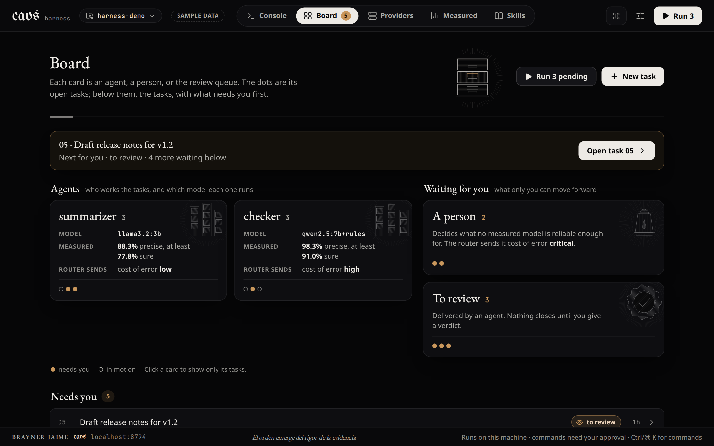
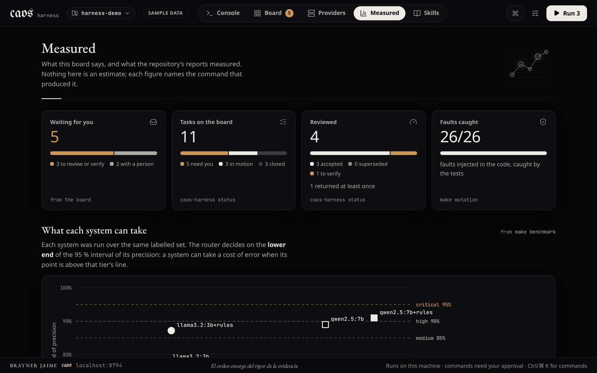
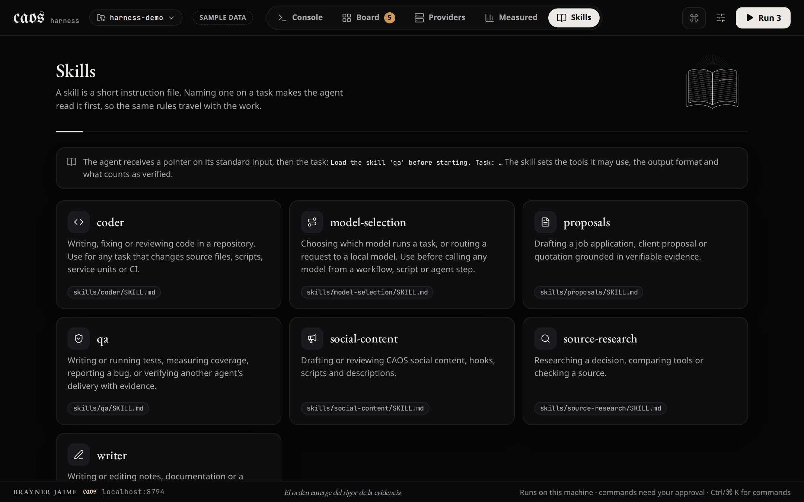
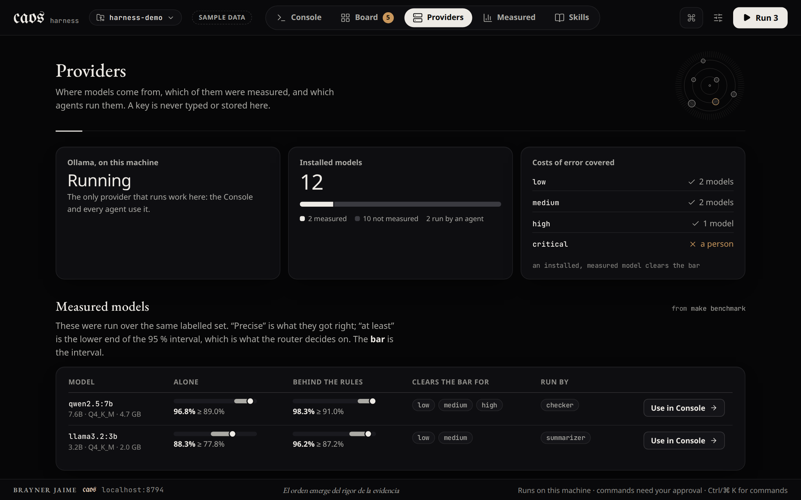
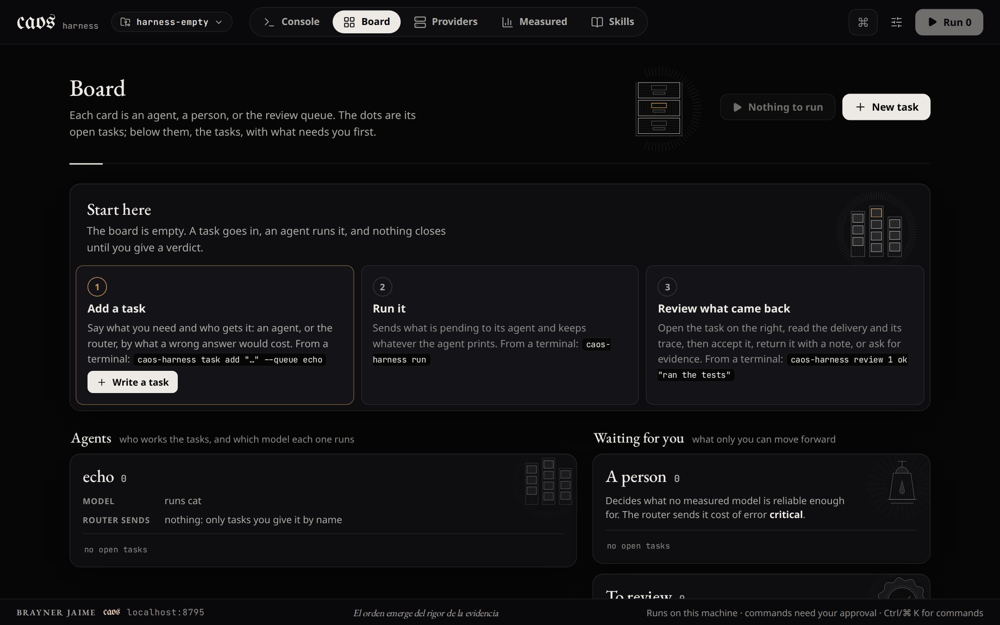
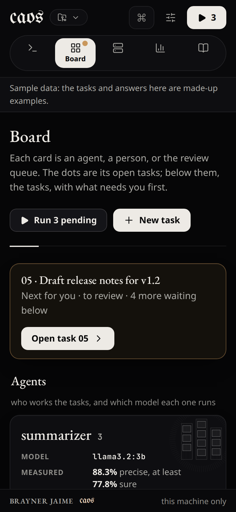

# Design notes: polishing the five-view dashboard

On 2026-11-11 the dashboard was reviewed critically. A first answer was an "operations desk" (one working screen instead of tabs). The project owner preferred the five-view dashboard as it was, polished, so the desk was dropped; its code is in history (commit `4cc108a`) and some of its parts were kept because they were plain improvements. This page records what was wrong, what was done to the five views, and what was kept from the detour.

The "before" images are in [docs/review/before/](review/before/). The "after" images are the ones the README uses.

## What was wrong

1. **Hard and boxed.** Sharp corners, hard borders, boxes inside boxes, and the same icon at the head of every panel. It read as a template.
2. **Hard to read.** Mono type for everything, small sizes, a muted text tier at 2.9:1 on black, long labels cut with an ellipsis.
3. **Empty and without a way in.** The console opened on "Start a session to begin"; the board on an empty table; nothing said where to start.
4. **The brand rule was broken.** Green on the Measured tiles, blue and purple icons, four selectable accent colours (emerald, silver, cyan) and a vignette, in a brand that has one warm colour.
5. **Numbers that did not explain.** Four cards with a big figure and nothing to show what it was made of.
6. **Wrong or dead things.** The Run button counted tasks waiting for a person (which `run` does not send); the new-task form defaulted to an agent named `qwen` whether or not the project had one; Spanish leftovers; a "+$ saved" label with no data; a failover form the server says is not implemented.
7. **Keyboard and focus.** One shortcut (⌘K), inconsistent focus rings, no way to move through tasks.

## What the five views are now

- **One shape for everything:** rounded corners at three radii (16 px for cards, 11 px for controls, 8 px for chips), a soft edge and a quiet shadow instead of hard rules, more air between rows and sections. No box sits inside a box.
- **Readable type:** 15.5 px body in the system sans (17 px with the *Large* text preference), EB Garamond for headings and the human voice, JetBrains Mono only for data and commands, never for sentences. No label is cut where it can wrap.
- **One icon set** (Lucide, 1.75 px stroke) for controls and states, and the repository's own hairline engravings for lanes and empty states, where they carry meaning and are large enough to read.
- **State by colour and shape:** each task state has an icon and a pill (amber and outlined when it needs you, bone when it moves, quiet when closed). Each queue card shows one dot per open task: filled amber for *needs you*, hollow for *in motion*.
- **Main actions in view:** *New task* and *Run N pending* at the top of the Board, the verdict buttons (Accept, Return with note, Needs evidence) with icons inside the open task.
- **A way in:** a new project shows "Start here", three steps that check themselves off by what the board holds, each with its terminal equivalent. The console starts the session with the first message and offers three real ways in; its limits (Plan runs nothing; shell commands are off and each asks first) are stated before you type.
- **Measured explains its figures.** Each tile carries a bar of its parts (waiting: to review vs with a person; tasks: need you, in motion, closed; reviewed: accepted, superseded, to verify; faults caught: caught of injected) and the command that produced it. Under them, each system's 95 % precision interval is drawn against the line each cost of error asks for, so you can see which tier it can take; the router's decision for each tier sits below.
- **Skills and Providers** are card grids with one icon per skill, descriptions at reading size, and the file path as a chip.

| | |
|---|---|
|  |  |
|  |  |
|  |  |

## Second round: what the owner asked for after seeing the polish

- **Own design, aligned with CAOS.** Every page now opens with its own engraving (a filing cabinet for the Board, orbits for Providers, a plotted line for Measured, an open book for Skills), drawn with the same hairline grammar as the rest of the set (`tools/art.py`, two new emblems: `workspace` and `models`), and a hairline that carries a short bright tick, the way the mark carries its amber one.
- **Workspaces.** The folder chip at the top is a menu: switch between listed folders, add one (checked: absolute path, real directory, valid `harness.toml`, or create the file when asked), remove one from the list. The browser can only open folders on the list; switching is refused while a run is going, and shell commands start off again.
- **Choosing a model.** A picker in the Console that shows, for each installed model, its size and quantisation, whether it was measured, how well, what it clears, and which agents run it. Measured models come first; a model that was never measured says the router will not choose it.
- **Providers say what they show.** Three plain statements at the top (provider, installed model, run by) and a table of the installed models with what is known about each; the other providers only say whether their key is in the environment.
- **The Board says more about each queue.** Each agent card shows the model it runs, its measured precision and lower bound, and which cost of error the router sends it. The new-task form labels each choice with the same figures.
- **A chart that tells models apart.** Reliability against time: one point per measured system, a different shape per model family, filled when it runs behind the rules, dashed lines for what each cost of error asks for.

## What was kept from the detour

The ⌘K palette that also finds a task by number or words; `j` `k` `n` `r`; *Preferences* (density, text size, start view); a footer that says what the server does (this machine only, commands need approval); amber used only for "needs you" and a bone primary button; a "Sample data" label; the keyboard focus ring; `prefers-reduced-motion` support; the interactive terminal session.

What stays from before the review, on purpose: the Fraktur name, the personal footer line, the Spanish motto (once, in the footer), the five-view navigation.

## Accessibility and motion

Text tiers are chosen against `#060607`: bone 16:1, grey 8.4:1, muted 5.6:1. One focus ring everywhere, skip link, `aria-current` on the navigation and the selected queue, `aria-expanded` on rows, a labelled combobox/listbox for the palette with focus returned on close. Motion is small: rows and trace events rising once, the intervals growing in, a pulse on a queue that is sending. `prefers-reduced-motion` removes all of it (the screenshots are taken with it on). The impeccable detector reports nothing on `web/src`.

## Still open

- Nobody but the author has used the first-run guide.
- The trace opens inline under its row; there is no side-by-side view of two tasks.
- Sessions in the console cannot be renamed.
