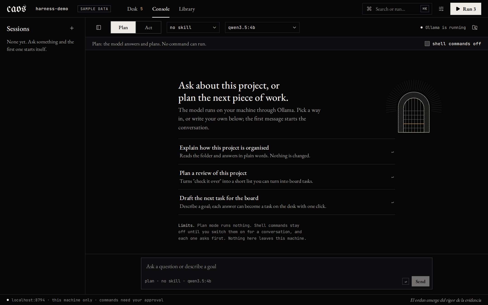
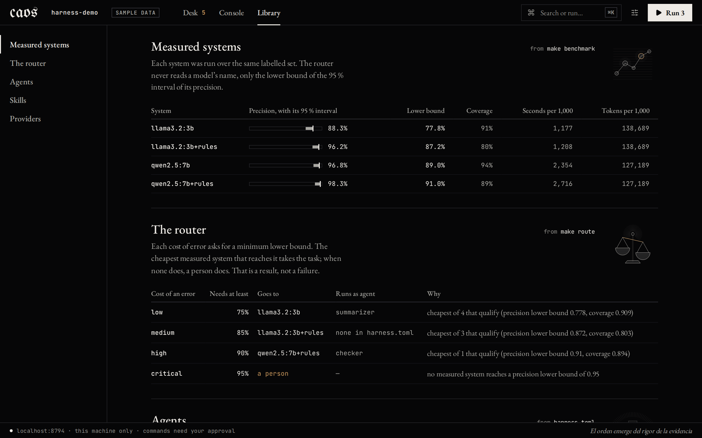
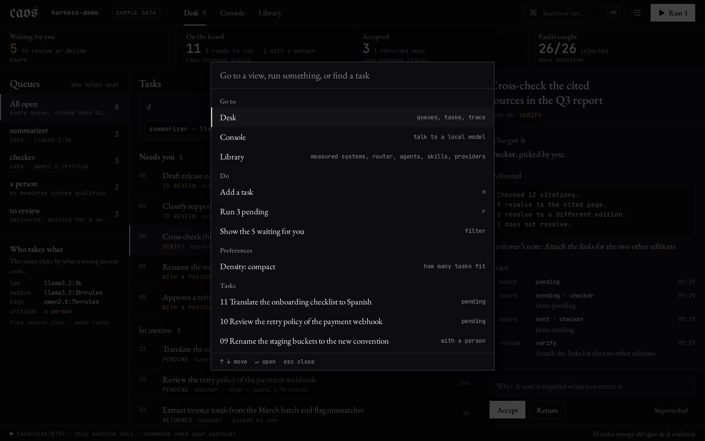
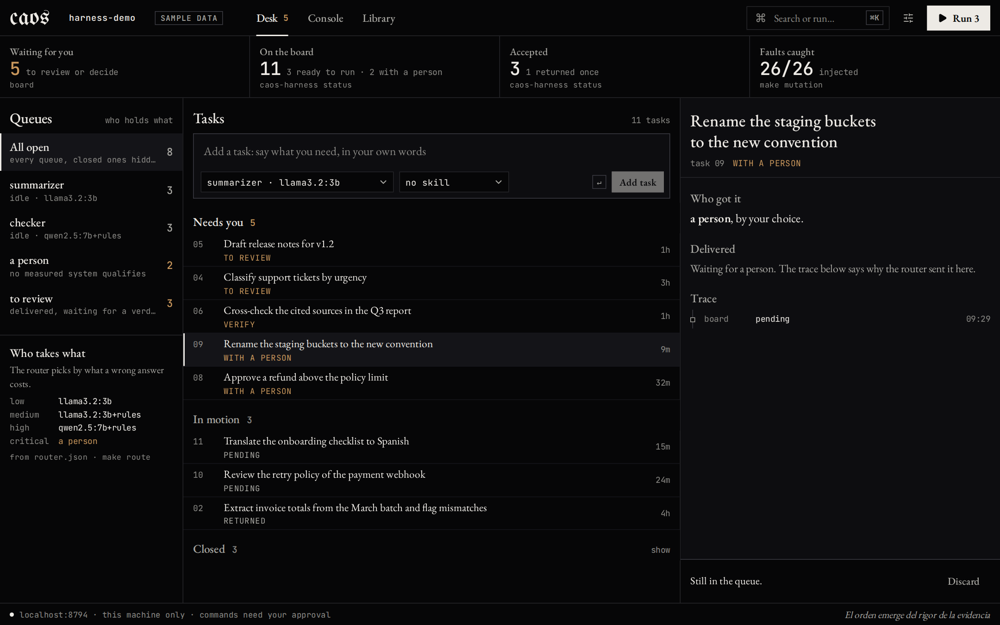

# Design review: from five tabs to one desk

A critical review of the dashboard and the CLI as they stood on 2026-11-11, what was changed, and what was deliberately left alone. The "before" images are in [docs/review/before/](review/before/); the "after" images are the ones the README uses.

## What was wrong, in order of impact

1. **It was five tabs of boxes, not a place to work.** Console, Board, Providers, Measured and Skills each opened a full-width panel with a header, an icon and a card grid. The one thing the product is about (a task's whole life: asked, routed, delivered, reviewed) lived inside one of the five. Nothing told you where to look first.
2. **The first minute was empty and gave no direction.** The console opened on "Your workspace / Start a session to begin" and a button; the board on an empty table. No path from "I just installed this" to "I closed my first task".
3. **The "Run" button lied.** It counted tasks waiting for a person (`Run (2)` with one runnable task), and the new-task form defaulted to an agent named `qwen` whether or not the project had one.
4. **The brand rule was broken in four places.** Green on the Measured cards, blue and purple icons in the console, four selectable accent colours (emerald, silver, cyan) and a vignette, all in a brand that has one warm element. Corners were rounded (8 to 14 px) although the brand is square.
5. **It looked like a template.** Every view repeated box inside box, a lucide icon beside every heading, uppercase tracked labels, the same card. The best thing in the repository, the hairline engravings, was shrunk into 30 px smudges behind queue names, where nobody could read them.
6. **Strings that were not English or not true.** Spanish leftovers in Providers and the console (`Clave API Pendiente`, `Cuota`, `Operador`, `ahorrado`), a Fallback card marked "not implemented" that had a form, a "+$ saved" label with no data behind it, an "alignment questions" feature the server never sends, and a personal name in every footer.
7. **Contrast and focus.** The muted text tier was 2.9:1 on black. Focus rings changed style per component. There was no keyboard way to move through tasks, and the palette was the only shortcut.
8. **Personalisation without function.** Accent colour and background texture changed nothing a person needs; density was the only setting that did.

## What the desk is now

One working screen. Left, the queues (who holds what) and, under them, the router's table (who takes what, from `router.json`). Middle, a one-line composer and the tasks grouped by what needs you: *Needs you*, *In motion*, *Closed*. Right, the selected task's whole life: who got it and why, what came back, the trace, and the verdict bar. Above, a line of four figures; each names the command that produced it, and none is computed from anything but the board's aggregates, the task list or a report a command wrote.

The page opens on the first thing that needs you, so the trace is never an empty box on a working board; accepting or discarding moves to the next one that needs you.

| | |
|---|---|
|  |  |
| **First run.** A guide that checks itself off by what the board holds (a task exists, something was delivered, something was reviewed), with the terminal equivalent of each step. It hides itself after the first verdict and can be dismissed. | **Console.** The first message starts the session; three real ways in; the limits of Plan mode and shell commands stated before you type. Shell commands are still off per conversation and each one still waits for approval. |
|  |  |
| **Library.** Measured systems (with the 95 % interval drawn, because the router decides on its lower bound), the router's tiers, agents, skills and providers in one reference page, one engraving per section. | **⌘K.** Go to a view, run something, or jump to a task by number or words. |
|  |  |
| **Compact density.** Eleven tasks fit without scrolling on a laptop screen. | **390 px.** Queues become a scrolling strip, the figures a 2×2 grid with their sources, the sample label its own line; the trace opens as a sheet. |

The CLI says the same things with the same words. `caos-harness` on its own is now a screen: where you are, what waits for you, the one or two commands worth running next. Colour only on a real terminal; never when piped and never with `NO_COLOR`.

## Decisions

- **Amber means "this needs you", and only that.** The primary button is bone, not amber. This is what makes the single warm element carry information: the count in the nav, the lane heading, the state of a task that waits for a person.
- **Square corners, hairlines, no cards.** Structure comes from rules and spacing. Nothing sits in a box inside a box.
- **Type by role.** Garamond for what a person writes and reads (task text, headings, notes); JetBrains Mono for evidence (ids, states, paths, figures, commands); Fraktur for the name only.
- **Engravings only where they carry meaning, and large.** The empty trace, the first-run guide, "nothing is waiting for you" (the check), an empty queue, each Library section, and the console's policy gate. Removed from queue rows, where they were noise.
- **Personalisation: two settings, both useful.** *Density* (comfortable or compact) and *Open on* (Desk, Console or Library). Removed: accent colours and the background texture. They live in a small popover from the top bar, stored in the browser only. The old `caos_env_settings` key is ignored.
- **The Spanish motto stays, once.** "El orden emerge del rigor de la evidencia" is the signature of the brand, and the only Spanish on screen. It is in the footer, never in a control or a sentence the operator has to act on, with its English meaning in the tooltip. It left the console's empty state, where it competed with the instruction.
- **The personal name left the footer.** The wordmark and the licence carry authorship; a name on every screen of a tool people will evaluate is a signature on the wrong place. It is one line to restore if wanted.
- **Sample data is labelled.** `tools/seed_demo.py` writes a `.harness/sample` marker; `/api/state` reports `sample: true`; the top bar shows "Sample data" on every screen.
- **Removed because it did nothing:** the failover form (the server says it is not implemented), "+$ saved" labels, alignment-question chips, the duplicate "add a task" form in the context drawer, the repository selector (the server serves one folder).
- **Safety is unchanged and visible.** Loopback only, writes need `X-Harness: 1`, no key is ever typed or stored (a provider takes the name of an environment variable), shell commands are off per conversation and each one asks. The footer and the console say so in plain words.

## Accessibility and motion

Text tiers are chosen against `#060607`: bone 16:1, grey 8:1, muted 5.4:1. One focus ring everywhere (`2px` champagne), skip link, `aria-current` on the nav, `aria-pressed` on queues and toggles, `aria-selected` on the selected task, a labelled combobox/listbox for the palette with focus returned on close. Motion is three things: the active nav underline drawing in, rows and trace events rising once, and a hairline that runs under the figures while a run is in progress. `prefers-reduced-motion` removes all of it (the screenshots are taken with it on). The impeccable detector reports nothing on `web/src`.

## What is still open

- Between 981 and 1240 px the desk keeps its three columns with narrower queues; at 980 px and below the trace opens as a sheet over the list (focus moves into it, Esc returns to the row). There is no swipe to dismiss.
- The Console has no empty-state illustration on narrow screens (the engraving hides below 1180 px).
- Sessions are listed but cannot be renamed.
- Nothing here has been used by anyone but the author yet. The first-run guide in particular wants a real first-time reader.

## Independent review

A fresh reviewer (the impeccable finish reviewer, no access to this conversation) read the screenshots and the code. Its material findings, all fixed: the sample label vanished on phones; the figure sources were cut off on phones and the safety line in the footer was clipped mid-word; the trace hid behind a click below 1240 px; a kicker sat above the trace title; the first-run steps dimmed below AA and used a text glyph as an icon; the console engraving touched its headline; and the task list had invalid ARIA (`role="list"` over buttons, `aria-selected` without an option role). Its question about a concept-roll seed key does not apply: the direction was fixed by the project owner, not rolled.
